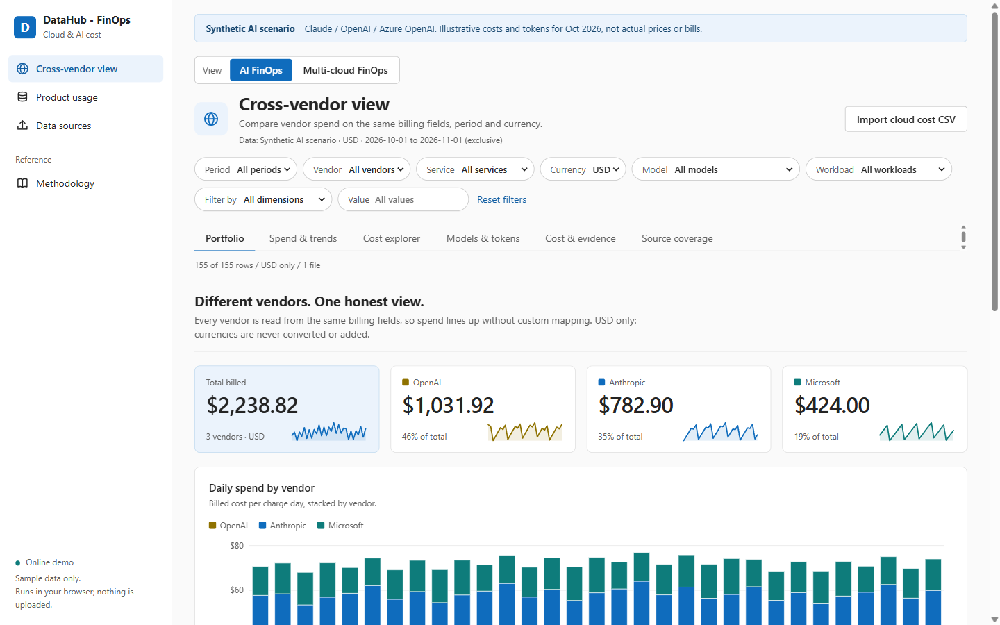

# DataHub - FinOps

Cloud and AI cost, product usage and licence spend in one local dashboard. It reads standardized
billing exports (the FinOps [FOCUS](https://focus.finops.org/) format) and shows what each vendor,
model and workload costs, next to what people actually use.



**Status: prototype on synthetic and sample data.** Nothing here is connected to a live tenant,
billing account or provider API. See [what is not built](#not-built-yet).

## Two views

| View | What it shows | Sample data |
|---|---|---|
| **AI FinOps** | Claude / OpenAI / Azure OpenAI spend, tokens, models and workloads | Synthetic scenario, October 2026 |
| **Multi-cloud FinOps** | AWS, Microsoft and Oracle spend on one set of billing fields | 1,000 rows of the official FinOps Foundation sample |

Both views share the same filters and cost explorer, and add a month-to-date run-rate. A separate **Product usage**
section covers Copilot Cowork, Copilot Studio, GitHub Copilot and Azure AI Foundry usage, plus an
estimated **licence cost** layer kept apart from billed totals so seats are never double counted.

## Try it

**Online demo.** Build the static demo and put the `dist/demo` folder on any web host. It runs the same
Python in the browser, so there is no server, and files a visitor imports are never uploaded.
See [demo/README.md](demo/README.md) for building it, embedding it in a page and hosting notes.

**On your machine.** Python 3.10 or newer, no packages needed:

```powershell
python app\server.py
```

Open <http://127.0.0.1:8765>. Import your own CSV on the **Data sources** page.
Details, data rules and the optional Fabric loader are in [app/README.md](app/README.md).

## What is in the repository

| Path | Contents |
|---|---|
| `app/` | The dashboard: Python parser and aggregator, local server, web UI and tests |
| `demo/` | Static, website-ready demo (Pyodide) and its build script |
| `samples/` | Sample billing data, product-usage feeds and a converter example |
| `docs/PLAN.md` | Design plan, scope decisions and open questions |

## Not built yet

- Live Claude, OpenAI or Copilot usage collectors, and any provider credentials handling.
- A page for entering prices when a provider reports usage without cost.
- Fabric deployment and Power BI publishing. The loader is written but has not run in a live workspace.

## Data and attribution

- All bundled data is synthetic or anonymised. Names, emails and identifiers in the product-usage feeds
  are fictional.
- `samples/focus/focus_sample.csv` is the unmodified FinOps Foundation FOCUS sample, used under
  [CC BY 4.0](https://creativecommons.org/licenses/by/4.0/). See [samples/focus/README.md](samples/focus/README.md).
- The online demo bundles [Pyodide](https://pyodide.org/) 0.29.5 (MPL-2.0), unmodified.
- `app/exporter_adapter.py` reads output from [focus-exporter](https://github.com/baselinehq/focus-exporter)
  (AGPL-3.0, with a commercial option). It does not bundle or run it; review its terms before distributing
  anything that does.

No licence has been chosen for this repository's own code yet.
