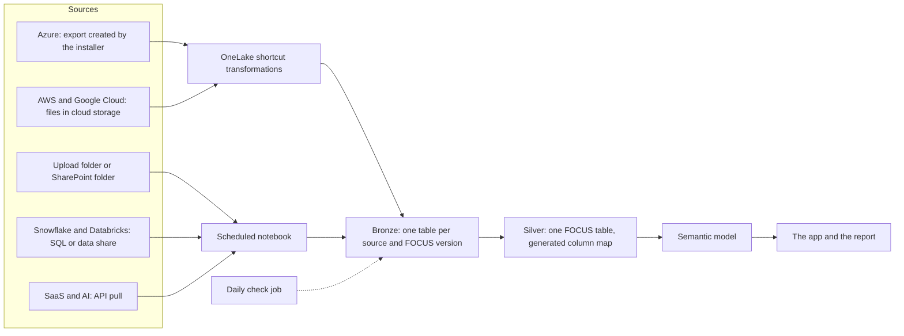
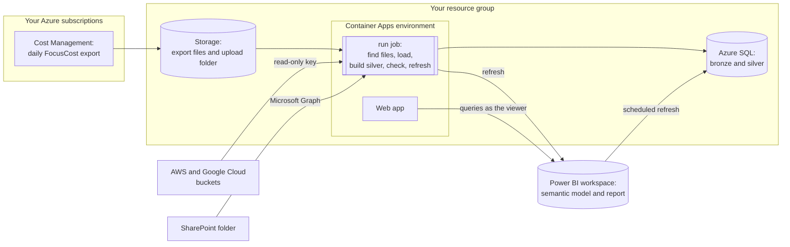
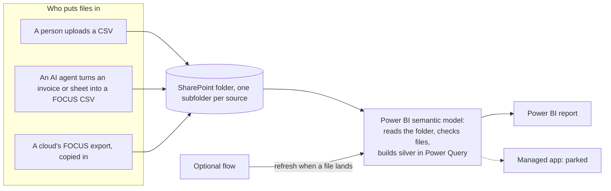

# DataHub - FinOps: design plan

> **Prototype available; cloud paths not deployed or supported.**
> Run the [local DataHub - FinOps prototype](https://github.com/microsoft/DataHub-App-for-Microsoft-Copilot-Agents-Cowork-and-Autopilots/blob/main/app/README.md). The design below is the
> longer-term plan, not a claim that its automation or deployment paths already work.

A DataHub-style app for cloud, SaaS and AI spend, built on the
[FinOps Open Cost and Usage Specification (FOCUS)](https://focus.finops.org/). Like DataHub, it runs on
Fabric or on Azure, and shows in an app and in Power BI reports. A third path needs only a SharePoint
folder and Power BI. Setup should take one command, and after that data should arrive with no
further steps. All three paths will be built, Fabric first.

## First prototype

**AI FinOps is the core use case**, including Claude/Anthropic, OpenAI and cloud-hosted AI.
The first prototype runs locally with one Python command, without cloud deployment or new packages.
It includes model/workload spend, token counters, CSV validation and an offline Fabric loader sharing
the same parser. The AI demo is explicitly synthetic; the official AWS/Microsoft/Oracle sample is
available separately. Neither sample is presented as the user's own usage.

Automatic Claude/OpenAI collectors, the Power BI model/report, Fabric deployment, Azure and SharePoint
connections are still to build. The current loader is bounded to small CSV snapshots, and is authored
but not live-validated on Fabric. It does not claim full FOCUS conversion or conformance.

**Expansion review, 17 November 2026:** the prototype has DataHub-style Cross-vendor pages and is
adding source-native Consumption Central views alongside FOCUS.
The [expanded scope](#expansion-beyond-the-prototype) below combines the multicloud financial view
with DataHub's deeper consumption capabilities. It is a proposed build plan, not implemented features.
The [Consumption Central review](#consumption-central-upstream-review) adds specific capabilities
from its upstream app and demo, with a recommendation to reuse selectively rather than replace the
current app wholesale.

## The idea

- FOCUS is one schema for cost and usage. Azure, AWS, Google Cloud, Oracle, Snowflake, Databricks and
  many SaaS providers already export it.
- So one model and one app can show every provider's spend side by side.
- Reuse DataHub's parts: the [installer](https://github.com/microsoft/DataHub-App-for-Microsoft-Copilot-Agents-Cowork-and-Autopilots/blob/main/installer/README.md), the [app](https://github.com/microsoft/DataHub-App-for-Microsoft-Copilot-Agents-Cowork-and-Autopilots/blob/main/app/README.md)
  and both architectures in [Architecture](https://github.com/microsoft/DataHub-App-for-Microsoft-Copilot-Agents-Cowork-and-Autopilots/blob/main/docs/ARCHITECTURE.md): [Fabric](https://github.com/microsoft/DataHub-App-for-Microsoft-Copilot-Agents-Cowork-and-Autopilots/blob/main/docs/ARCHITECTURE.md#fabric)
  and [Azure](https://github.com/microsoft/DataHub-App-for-Microsoft-Copilot-Agents-Cowork-and-Autopilots/blob/main/docs/ARCHITECTURE.md#azure). That's shortcuts or jobs, then a Lakehouse or Azure
  SQL, a semantic model, Power BI reports and the app.
- The third path is a SharePoint folder. Someone drops a CSV in it, or an AI agent writes one there,
  and Power BI reads it. That needs no Fabric or Azure. See [SharePoint folder](#sharepoint-folder).
- All three paths use the same tables and measures, so the report and the app show the same numbers.

## What it's built from

| Source | What it gives | How the plan uses it |
|---|---|---|
| [FOCUS spec datasets, v1.4](https://github.com/FinOps-Open-Cost-and-Usage-Spec/FOCUS_Spec/tree/v1.4/specification/datasets) | One Markdown file per column, each with a constraints table: dataset, column type, feature level, nulls, data type, allowed values and the version it arrived in | Generate the Lakehouse tables, data types and the version map from these files, not by hand |
| [FOCUS spec datasets, working draft](https://github.com/FinOps-Open-Cost-and-Usage-Spec/FOCUS_Spec/tree/working_draft/specification/datasets) | The unreleased v1.5, which adds the SKU Price dataset as a preview | Track it for the next version. Don't build on it |
| [Requirements model](https://github.com/FinOps-Open-Cost-and-Usage-Spec/FOCUS_Spec/tree/working_draft/specification/requirements_model) | Machine-readable rules for v1.2 to v1.5. v1.4 adds JSON schemas | Generate the data quality checks |
| [Column Library](https://focus.finops.org/docs/column-library/) | Every column, by version and FinOps capability | Field descriptions in the model and the app |
| [Getting started with FOCUS datasets](https://focus.finops.org/docs/implementation/get-started/get-started-with-focus-datasets/) | Which providers export which FOCUS version | The installer's source list |
| [FOCUS use cases (v1.4)](https://focus.finops.org/docs/use-cases/v1-4/) | Worked SQL for allocation, anomalies, budgets, forecasts, invoices and rate optimisation | The model's measures and the app's pages |
| [FOCUS sample data](https://github.com/FinOps-Open-Cost-and-Usage-Spec/FOCUS-Sample-Data) | Anonymised AWS, Google Cloud, Microsoft and Oracle rows (FOCUS 1.0) | Demo mode and tests |
| [AWS FOCUS dashboard](https://docs.aws.amazon.com/guidance/latest/cloud-intelligence-dashboards/focus-dashboard.html) | An Athena view that merges several FOCUS versions, and finds new tables itself | Copy the merged view. Find new tables on every run, with no prompts. Use its pages as the feature benchmark |
| [focus-exporter](https://pkg.go.dev/github.com/baselinehq/focus-exporter) | FOCUS 1.2 from 12 SaaS and AI APIs, including OpenAI, Anthropic, GitHub and Cloudflare | Optional source. See [AI and SaaS spend](#ai-and-saas-spend) |
| [axigate-finops](https://github.com/axigatelabs/axigate-finops) | An AI gateway that records spend per agent and run, and writes FOCUS | Optional source. See [AI and SaaS spend](#ai-and-saas-spend) |
| [Cost Management exports](https://learn.microsoft.com/en-us/azure/cost-management-billing/costs/tutorial-improved-exports) | Scheduled FOCUS exports of Azure cost to storage, with file partitioning, overwrite, a rerun for a past period, and support for firewalled storage | The Azure source, on both paths |
| [DataHub on Azure](https://github.com/microsoft/DataHub-App-for-Microsoft-Copilot-Agents-Cowork-and-Autopilots/blob/main/azure/DESIGN.md) | How DataHub runs outside Fabric: Container Apps jobs, Azure SQL, a managed identity and an Import model | The Azure path |
| [DataHub's upload folder](https://github.com/microsoft/DataHub-App-for-Microsoft-Copilot-Agents-Cowork-and-Autopilots/blob/main/installer/README.md#data-sources-and-exports) | A Lakehouse folder that recognises each file by its column headers, loads it once and logs it. It can be a SharePoint or OneDrive shortcut. On Azure, DataHub's jobs read a SharePoint folder through Microsoft Graph | The pattern for the SharePoint path, and for files on the other two |
| [OneDrive and SharePoint shortcuts](https://learn.microsoft.com/en-us/fabric/onelake/shortcuts/create-onedrive-sharepoint-shortcut) | A Lakehouse shortcut to a SharePoint or OneDrive folder, signed in as an organisational account, a workspace identity or a service principal | The SharePoint folder on Fabric |
| [SharePoint folder connector](https://learn.microsoft.com/en-us/power-query/connectors/sharepoint-folder) | Power BI reads every file in a SharePoint folder. Generally available, for semantic models | The SharePoint path, with only Power BI |

## Data model

The FOCUS data model has these datasets. v1.4 has the first four.

| Dataset | Type | Required | In the semantic model |
|---|---|---|---|
| Cost and Usage | Transaction | Always | Main fact table |
| Invoice Detail | Transaction | When there are payable invoices | Second fact table |
| Billing Period | Reference | When there are payable invoices | Dimension |
| Contract Commitment | Reference | When there are contract commitments | Dimension |
| SKU Price (v1.5 preview) | Reference | When there's unit pricing | Dimension, later |

**Joins to confirm in Phase 0.** Cost and Usage to Invoice Detail on `InvoiceDetailId`. Cost and Usage
to Billing Period on `InvoiceIssuerName` and `BillingPeriodStart`, which needs a combined key in Power
BI. Contract Commitment through `ContractApplied`, which has to be unpacked into a bridge table first.

**Spec rules that shape the model:**

- `BilledCost` must be 0 for charges from anyone not responsible for invoicing. That stops double
  counting, so billed cost can be summed safely across providers and dataset instances.
- `EffectiveCost` is the amortised view. Use it for showback, and `BilledCost` for invoices.
- FOCUS rows aren't guaranteed unique. So each load replaces a whole billing period for one source,
  rather than merging rows.

## Sources

| How it arrives | Providers | What's automatic |
|---|---|---|
| Export created through an API | Azure | Everything. The installer creates a storage account, or uses one you choose, and a daily `FocusCost` export to it with the [Exports API](https://learn.microsoft.com/rest/api/cost-management/exports/create-or-update). The export overwrites each period and is partitioned for large datasets |
| Files in cloud storage | AWS ([FOCUS 1.2 export](https://docs.aws.amazon.com/cur/latest/userguide/table-dictionary-focus-1-2-aws.html)), Google Cloud, Oracle | A one-time snippet the installer gives you. Then a OneLake shortcut (Fabric) or the run job (Azure) does the rest |
| SQL or data share | Snowflake, Databricks | A scheduled pull |
| API pull | SaaS and AI providers | A scheduled job |
| A SharePoint folder, or an upload folder | Anything else, including files an AI prepared | Drop a CSV file in. On Fabric and Azure the next run picks it up. See [SharePoint folder](#sharepoint-folder) |

## Fabric, Azure or SharePoint

Same as DataHub, the installer asks first. All three paths read the same kinds of file, build the
same silver table and give the same report. Only how files become tables differs. **Build order:
Fabric, then Azure, then SharePoint.** A SharePoint folder is also a source on Fabric and Azure, as
DataHub's upload folder is. Azure's exports need a small storage account in an Azure subscription,
even on Fabric.

| | Fabric | Azure | SharePoint |
|---|---|---|---|
| Needs | A Fabric workspace | An Azure subscription | A SharePoint site and Power BI |
| Runs as | Shortcut transformations, a notebook and a pipeline | A Container Apps run job, signed in as a managed identity | Power Query, inside the model's own refresh |
| Tables | Lakehouse (Delta) | Azure SQL | Inside the Import model |
| Model | Direct Lake, or Import over the SQL endpoint | Import, with incremental refresh | Import |
| Azure cost data | Automatic | Automatic | A person or a flow copies the file in |
| A reloaded period | The shortcut sees the new file | The job replaces the period | The newest file for the period wins |
| Front end | The app and the report | The app and the report | The report. A managed app is parked |
| Main costs | Fabric capacity. Shortcuts poll all the time | Container Apps, Azure SQL, Storage | Power BI licences |
| Viewers | Power BI Pro or PPU each, below F64 | Power BI Pro or PPU each | Power BI Pro or PPU each |
| Best for | The default | Customers with no Fabric | A quick start, or small and mid-sized data |

### Fabric

1. **Sources.** The installer creates what it can, and gives a snippet for the rest. Files someone
   uploads, or puts in a SharePoint or OneDrive folder, come in as DataHub's upload folder does. The
   folder is a [shortcut](https://learn.microsoft.com/en-us/fabric/onelake/shortcuts/create-onedrive-sharepoint-shortcut).
   A scheduled notebook recognises each file's FOCUS version from its headers, loads it once and logs
   it. The Fabric tenant setting for OneDrive and SharePoint shortcuts must be on.
2. **Bronze.** [Shortcut transformations](https://learn.microsoft.com/en-us/fabric/onelake/shortcuts/transformations)
   turn CSV and Parquet into Delta tables. They poll about every 2 minutes, and drop rows when a file
   is removed. Each shortcut needs one schema, so there's one per source and FOCUS version.
3. **Silver.** One `focus_cost_and_usage` table. Built from a view that merges every bronze table it
   finds, like the AWS dashboard, but with no prompts.
4. **Model.** Direct Lake over silver, so there's no import refresh. See [Power BI](#power-bi).
5. **Daily check.** It finds new scopes and tables, schema changes and late data, and posts to Teams.

### Azure

The shape of [DataHub on Azure](https://github.com/microsoft/DataHub-App-for-Microsoft-Copilot-Agents-Cowork-and-Autopilots/blob/main/docs/ARCHITECTURE.md#azure), with FOCUS data.

1. **Run job.** A Container Apps job that signs in as a managed identity, so there's no secret to
   rotate. It finds new and changed export files, loads each source and FOCUS version, replaces the
   whole billing period for that source in one transaction, and rebuilds silver. Daily by default.
   The image comes from public GHCR, so no container registry is needed, as in DataHub.
2. **Azure SQL.** Bronze and silver tables. Silver would use a columnstore index. Size it in Phase 0.
3. **Model.** Import, with incremental refresh by billing month. The job then refreshes only the
   months it changed.
4. **Daily check.** A step of the same job, with the same checks and Teams alerts as on Fabric.
5. **Web app.** Queries the model as the person viewing, so they see only what they're allowed to.
   Also runs as a Teams tab.
6. **Other clouds.** The job reads AWS and Google Cloud buckets with a read-only key, kept in Key
   Vault. Or the snippet copies their files into the storage account. Check which is simpler.
7. **SharePoint folder.** The job can also read a SharePoint folder through Microsoft Graph, as
   DataHub's jobs do. Its managed identity gets Sites.Selected read on the site. A SharePoint
   administrator grants that by hand.

**Access it needs:**

- To create an export: Owner or Contributor on the subscription, or the matching billing role on EA
  and MCA scopes, and write access to the storage account.
- To export to a storage account with a firewall: Owner on it, once. The export then runs as its own
  managed identity. That needs Exports API 2023-08-01 or later.
- The storage account must allow copies from any storage account.
- The run job's managed identity: read on the export storage, write on Azure SQL, and member of the
  Power BI workspace for refresh, as in DataHub.

[Least-privilege Azure install](https://github.com/microsoft/DataHub-App-for-Microsoft-Copilot-Agents-Cowork-and-Autopilots/blob/main/docs/AZURE-LEAST-PRIVILEGE.md) is the model to follow for the
resource group.

### SharePoint folder

The lightest path. It needs a SharePoint site and Power BI, and nothing in Fabric or Azure. Power BI
reads the folder itself, with the
[SharePoint folder connector](https://learn.microsoft.com/en-us/power-query/connectors/sharepoint-folder).

1. **Folder.** One document library folder, with a subfolder for each source. Nothing to install.
2. **Who adds files.** A person who uploads a file they downloaded. An AI agent that turns a bill
   that isn't FOCUS, such as a SaaS invoice, a PDF or a vendor spreadsheet, into a FOCUS CSV. Or a
   cloud's own FOCUS export, copied in by a person or a flow.
3. **Checks.** Each file's FOCUS version is read from its headers, as DataHub recognises an upload.
   Columns are mapped with the map generated from the spec, and rows are checked against the
   requirements model. Power BI can't move a file, so one that fails stays where it is. The Data
   quality page lists it with the reason.
4. **Silver.** Power Query builds the same silver table. It keeps only the newest file for each
   source and billing period, so a corrected upload replaces the old one.
5. **Model and report.** Import, on a scheduled refresh. An optional flow refreshes it as soon as a
   file lands.
6. **Refresh identity.** The connector accepts an organisational account or a workspace identity.
   Use an account that isn't one person's, or refresh stops when they leave.

**AI-prepared files.** The plan defines the contract and the checks. Who builds the agent is open.

- Every AI-prepared row sets `x_PreparedBy` to `ai`, so the pages can label it.
- The agent also records the source document's own total in `x_SourceTotal`. The check compares it
  with the sum of `BilledCost`, and fails the file if they differ.
- An AI can misread a bill. So the Data quality page shows how much spend is AI-prepared, and how
  many files failed.

**Access:**

- The refresh identity needs read on the folder.
- People who add files need Contribute on that folder only. Anyone who can write there can change
  the numbers, so limit who can, and keep version history on.
- Viewers need nothing on SharePoint. They see the model through the report.

## FOCUS versions

Providers export FOCUS v1.0 to v1.3 today, mostly v1.2. Silver stores the latest released version,
v1.4.

- **Renamed columns.** v1.2's `ProviderName` and `PublisherName` are gone by v1.4. v1.3 added
  `ServiceProviderName` and `HostProviderName`. The map from old to new comes from the spec files.
  Check each case against real exports.
- **Columns a source doesn't have** are null.
- **Provider columns** start with `x_`. They're kept in one `x_extensions` JSON column, so no data is
  lost.
- Every row records its source and FOCUS version.
- A file from a folder doesn't say its version. It's worked out from its column headers, for example
  `ServiceProviderName` means v1.3 or later. Check each case against real exports.

## Pages

Keep the DataHub visual language, but make the pages answer operational questions rather than
repeat the same spend chart with different groupings. Tables belong in drill-through and exports,
not as the default overview.

| Page | Questions it answers | Primary visuals | Data needed |
|---|---|---|---|
| Portfolio | What did we spend, what changed, and where should we look first? | KPI sparklines, provider/product small multiples, change-contribution waterfall, source-coverage strip | FOCUS cost; native consumption summaries beside it, not added to it |
| Cost explorer | Which account, service, region, resource or project caused the change? | Linked monthly and daily charts, ranked movers, service/resource treemap, tag heatmap | FOCUS dimensions, quantities, units, prices and tags |
| Consumption | Who or what consumed credits, tokens, requests and seats, and what tasks did they support? | Product tabs, prepaid/PAYG stacks, model/feature/task-mix bars, concentration curves, allowance bullet charts | DataHub consumption facts, optional task exports and Claude/OpenAI usage feeds |
| Rates, packs and commitments | What is prepaid, what spills into PAYG, and where is capacity underused? | Pack burn-down, price-basis comparisons, commitment coverage/utilisation, scenario comparisons | Commercial terms, entitlements, commitment data and deployment telemetry |
| Budgets and trends | When might a budget be crossed, and which change needs investigation? | Actual/pace/budget lines, labelled scenario bands, anomaly timeline, positive and negative movers | Dated costs, saved budgets, ingestion completeness and sufficient history |
| Allocation and showback | Which team, application or cost centre owns the cost, and what remains unassigned? | Cost-centre heatmaps, allocated/unallocated stacks, application breakdowns, ownership coverage | Tags, org attributes, approved identity/resource mappings and allocation rules |
| Efficiency and value | Is increased usage improving outcomes, and what should an owner review? | Cost-versus-quality scatterplots, deployment utilisation/latency panels, unit-cost trends, evidence-backed action cards | Consumption plus Azure health; optional ValueLens and Agent Evaluator data |
| Billing and data trust | Can these totals be explained and traced back to the source? | Billed/estimated variance waterfall, coverage matrix, source timeline, reconciliation states | Source manifests, source precedence, invoice evidence when supplied and ingestion status |

Natural-language questions should be a contextual drawer over these pages, not an alternative
source of numbers. Answers must carry the measure, filters, period, currency, source and drill-through
link. No generated recommendation should claim a verified saving or change a cloud resource.

## Expansion beyond the prototype

### What was actually inspected

- The [AWS multicloud Storylane walkthrough](https://app.storylane.io/share/zutqlizt5v45):
  its Billing Summary and Monthly Trends flows demonstrate selectable cost bases, group-by controls,
  monthly and daily costs, effective-versus-list comparisons, project/tag allocation, linked filtering,
  month-on-month movers and drilling down to individual resources. These are useful interaction and
  capability references; their demo numbers are not input data for this project.
- The repository's [Consumption Central template](https://github.com/microsoft/DataHub-App-for-Microsoft-Copilot-Agents-Cowork-and-Autopilots/tree/main/fabric/Add%20Credit%20Consumption/),
  its embedded model metadata, [source contracts](https://github.com/microsoft/DataHub-App-for-Microsoft-Copilot-Agents-Cowork-and-Autopilots/blob/main/fabric/Add%20Credit%20Consumption/DATA-DICTIONARY.md)
  and the [Consumption app implementation](https://github.com/microsoft/DataHub-App-for-Microsoft-Copilot-Agents-Cowork-and-Autopilots/tree/main/app/src/screens/consumption/).
  The bundled Fabric template contains **36 model tables and 385 measures**, including helpers,
  parameter tables and scenario measures. That is not 385 validated production insights or a claim
  that any particular tenant has these feeds connected.
- The [FOCUS sample](../samples/focus/README.md) and
  [prototype parser](https://github.com/microsoft/DataHub-App-for-Microsoft-Copilot-Agents-Cowork-and-Autopilots/blob/main/app/focus_core.py). The sample has **44 columns**. Only
  `BilledCost` and `EffectiveCost` are currently parsed as money; many other fields are retained only
  in `RawRecord`, or are parsed dimensions with no dedicated view.

**Already present in the 1,000-row FOCUS sample:** list cost on 1,000 rows, contracted cost on 993,
consumed quantity/unit on 999, resource IDs on 925, tags on 711 and commitment IDs/status on four.
Tags include application, environment, business unit, project and cost-centre variants. There is
substantial scope to expand the real sample without inventing fields. However, it is a partial
extract: it cannot establish complete invoices, representative commitment utilisation or a reliable
multi-month forecast.

### Reuse DataHub's depth, not just its appearance

| Capability | Existing repository evidence | What to bring into this dashboard | Limits to preserve |
|---|---|---|---|
| Cowork / Work IQ | `viva_credits_weekly`, `viva_spending_policy`, `CoworkBilling`, `CreditsWeekly`; existing Cowork app stage | Credits and sessions by service, person, department and policy; allowance/headroom; prepaid/PAYG split; cost per user/session; concentration, growth and ungoverned usage | Weekly grain; identified exports needed for person-to-org joins; policy allowance is not purchased capacity; zero/blank limits mean no configured limit |
| Copilot Studio | Tenant daily, agent/user snapshot and API daily tables; existing Studio stage | Credits by environment, agent, model, feature and channel; entitlement burn; concentration; attributed versus unattributed usage; Azure-billed PAYG comparison | Tenant, agent and user views overlap and must not be added; user totals can be a lower bound; monthly snapshots are not daily events; some API detail is best effort |
| GitHub Copilot | `GitHub Usage`, `GitHub User`, dedicated consumption/cost/optimisation/forecast report pages, API and CSV ingestion notebooks | Seat and overage costs, included allowance, model/SKU mix, developer concentration and cost-centre attribution | Present in the bundled template, but no dedicated GitHub stage in the current app's Consumption screen; API lacks CSV repository/quota detail; zero billed credits does not mean an inactive developer |
| Azure / Foundry | `AzureAiSpend`, `AzureAiTokens`, `AzureSolutionSpend`, `AzureDeploymentHealth`, `AzureBillingReconciliation`; app spend/inventory views | Model plus supporting infrastructure cost, PAYG versus provisioned cost, input/output/cache mix, PTU capacity/utilisation, requests, throttles, errors and latency | Health and reconciliation ingestion is best effort; deployment telemetry is not a FOCUS bill; speech hours, document pages and images are currently uncollected |
| Commercial terms and budgets | `commercial_terms`, rates/packs settings and budget-runway logic | Negotiated rates, capacity balances, budget-crossing dates and explicit what-if scenarios | Existing app rate overrides do not change the report's model rates; the new app/report need shared, effective-dated settings to promise parity |
| Adoption, outcomes and value | Separate ValueLens and Agent Evaluator models | Cost per resolved conversation, cost versus estimated value, quality/cost comparisons and capacity review candidates | These are extra feeds, not Consumption Central fields. Require compatible identities, dates, scopes and denominators; estimated time value is not realised cash savings |
| Cross-vendor enterprise usage | [Cross-vendor contract](https://github.com/microsoft/DataHub-App-for-Microsoft-Copilot-Agents-Cowork-and-Autopilots/blob/main/app/src/screens/cross-vendor/contract.json) and demo-gated app panels | Native Claude/ChatGPT/Cursor usage alongside cost; keep message, coding and session metrics in their own units | Current adapters/panels are fixtures or synthetic scenarios, not verified live integrations. Do not infer cross-vendor people, tokens, productivity or seat cost from them |

The [installer's model transform](https://github.com/microsoft/DataHub-App-for-Microsoft-Copilot-Agents-Cowork-and-Autopilots/blob/main/installer/src/transform/model.js) retains the consumption
template and adds Copilot Azure PAYG billing and optional Foundry resource inventory. The app exposes
only part of the template. Therefore there are two different jobs: surface existing model capability,
and connect missing sources. Neither should be described as starting from scratch.

Measure names alone are not sufficient acceptance evidence. Before reusing a measure, inspect its
filter context, rate assumptions, snapshot behaviour and sample-specific logic. The template includes
prototype/scenario and fictional-evidence labels; those cannot become production findings by renaming
them. The [methodology](https://github.com/microsoft/DataHub-App-for-Microsoft-Copilot-Agents-Cowork-and-Autopilots/blob/main/docs/METHODOLOGY.md#81-consumption) documents important current caveats.

### Consumption Central upstream review

**Reviewed 17 November 2026:** the
[upstream repository at `5a35434`](https://github.com/microsoft/ConsumptionCentral-for-Microsoft-Copilot/tree/5a35434dcd620e07e3cb6d368f456456da5f5556)
and the [public Consumption Central demo](https://ai-datalab.github.io/demo/consumption-central/).
The demo review covered Overview, Cowork chargeback/tasks/optimisation/forecast, Studio and GitHub
optimisation, and Azure capacity/health and reconciliation. Its data is synthetic; demo availability
does not prove a collector exists or works in our deployment.

**Recommendation: use Consumption Central as the consumption capability scaffold, retain DataHub's
app/deployment scaffold, and add FOCUS as the cross-vendor financial layer.** This does not require
starting again or importing a second entire app. Keep the requested DataHub appearance and chart-first
interaction; selectively port the capabilities below.

There are two distinct upstream applications, and they should not be confused:

| Upstream component | What it actually does | Reuse decision |
|---|---|---|
| [`app/`](https://github.com/microsoft/ConsumptionCentral-for-Microsoft-Copilot/tree/5a35434dcd620e07e3cb6d368f456456da5f5556/app) | Browser CSV app; TypeScript ports of report calculations; offline single-file build; also hostable as a managed or Fabric app | Reference for product views, header-based file recognition, glossary and sample/empty states. Not an unattended-ingestion backend or a semantic-model connection merely because it is hosted in Fabric |
| [`fabric-app/`](https://github.com/microsoft/ConsumptionCentral-for-Microsoft-Copilot/tree/5a35434dcd620e07e3cb6d368f456456da5f5556/fabric-app) | Queries published semantic models as the viewer; bounded detail, lazy tab loading, throttling handling, source availability, reporting and optional data-agent integration | Closest production pattern for Fabric-first. Reuse compatible behaviour in the existing DataHub shell rather than introducing another fork of the entire application |
| Templates and Fabric ingesters | Product-specific facts, commercial assumptions, measures and pipelines | Preserve the Microsoft product calculations and add FOCUS/native vendor facts beside them. Check each reused calculation and source contract |
| [`installer/`](https://github.com/microsoft/ConsumptionCentral-for-Microsoft-Copilot/tree/5a35434dcd620e07e3cb6d368f456456da5f5556/installer) | Fabric route plus SharePoint/PAX route; saved setup, preflight, approval, repair and first-load checks | Reuse relevant flows. Retain this project's Azure route and Fabric-first order; do not assume the SharePoint route collects every product automatically |

#### Specific extras to include

These are additions or explicit acceptance requirements for the earlier page outline, not another
set of disconnected pages. B/C/D refer to the build increments below.

| Extra from Consumption Central | Where it belongs and how it should look | Required evidence and limits | Increment |
|---|---|---|---|
| Task mix and task intensity | Consumption: category share bars, scheduled versus user-initiated weekly stacks, credits and reference cost per task | An actual task export, separate from ordinary credit/session facts. Do not equate reported task counts with successful outcomes or invent tasks for providers reporting only tokens | B |
| Task value scenarios | Efficiency and value: conservative/typical/optimistic effort assumptions, optional hourly value and mapped-category coverage | Unknown categories stay in observed totals but receive no invented effort value. Expert-equivalent hours/value are estimates, not measured time saved. Keep PAYG reference cost distinct from allocated licence/prepaid cost | D |
| Policy-level chargeback | Allocation: cost-centre/department bars and heatmap; drill to spending policy, billing owner and charge code; exportable detail | Optional policy billing metadata plus credits and commercial terms. Retain an unassigned bucket. If prepaid cost is allocated pro rata, derive the share at the pool scope before filtering so a filter cannot reprice a department | B |
| Allowance review queue | Rates/capacity and Efficiency: action-count bars, concentration plots and owner review cards before a detail queue | Distinguish no use in supplied history, no use in the current window, occasional spikes and persistent excess. Limits are not purchased capacity; price-valued allowance changes are not booked savings. No automated limit changes | C |
| Studio entitlement triage | Consumption: environment entitlement/PAYG mix, agents ranked by volume and billed share, unattributed credits | A user snapshot does not contain user-specific policy limits or enforcement state. Only offer the actions supported by the actual source, not a generic rightsizing recommendation | B/C |
| GitHub seat and pool economics | Consumption: seat cost versus net usage overage, included-pool burn, plan/model/coding-agent mix and cost-centre concentration | Seat cost and usage cost must have explicit period and scope. No credit usage does not establish no developer activity. Allowance rules and prices must be effective-dated, not copied from demo defaults. **Prototype status:** a local Licenses page estimates seat cost from sample seat assignments and an illustrative effective-dated rate card (`Billed in FOCUS` plans excluded to avoid double counting); included-pool burn is not built | B |
| Growth and capacity scenarios | Budgets: flat/current-pace versus growth lines, adjustable horizon, monthly/year totals, evidence-qualified confidence | Label scenario ranges as scenarios, not statistical confidence intervals. Carry observed history and backtest quality where available; do not apply one product's growth or entitlement rules to another | D |
| Deployment health beside cost | Efficiency: PTU utilisation and request-weighted latency bars, request/error/throttle trends, workload drill-through | Latest capacity snapshot is not additive across months; health covers an observed period. Missing metrics are unknown, and low utilisation alone does not justify removing capacity | C |
| Reconciliation with an explained residual | Billing/trust: usage estimate, billed amount, documented adjustments and remaining difference | Compare only matching period, currency and billing pool. The demo's fictional evidence must never become a real adjustment. Supporting solution costs remain outside a narrower model-billing pool | C |
| Explainability and self-service | All pages: metric definitions, cost-basis/source labels, source availability, detail CSV; later reusable report packs/PDF/PowerPoint | Preserve active filters, source dates and assumptions in exports; full-population totals must not be derived from capped detail lists | B; richer exports D |

#### Extend the architecture, not the four-product assumptions

The upstream CSV app's product list and dataset types are explicitly Microsoft-product-specific.
Adding Claude or OpenAI is therefore more than adding a tab. Define a provider/product capability
registry covering source types, native units, periods, cost bases, supported dimensions and eligible
views. A product can support Consumption and Cost without supporting Tasks, Capacity or Forecast.
Do not synthesise fields merely to fill the standard layout.

Use the common **Consumption / Cost / Allocation / Review / Forecast** lenses where supported, with
product-native detail underneath. A cross-vendor comparison must identify whether it compares
source-reported bills, usage-price estimates, amortised costs or seat allocations. The demo's
Overview deliberately has **no grand cost or credit total**: Cowork is a PAYG reference value,
Studio uses configured rates, GitHub uses exported net usage excluding seats, and Azure uses export
cost. Preserve this distinction. Only a separate, reconciled, non-overlapping FOCUS financial view
may produce a combined total for compatible periods, scope and currency.

The CSV app calculates money using JavaScript `number`. Reuse its metric definitions as reference,
not as the exact financial ledger for this project: keep source decimal precision, explicit currency
and tested rounding. Avoid a third independent set of commercial rules. Cross-check the offline
adapter and Power BI measures against the same source fixtures and configuration versions.

#### Integration checks before code is imported

- **Reconcile versions.** Our bundled copy is documented as based on `24b0ca8`; this review used
  upstream `5a35434`. The prior 36-table/385-measure count describes our bundled template, not this
  upstream release. Compare changes before importing files, particularly newer Tasks/Chargeback
  work and DataHub's existing ingestion extensions. Pin reused code and preserve MIT notices.
- **Prove feeds, not screenshots.** Upstream's
  [testing guide](https://github.com/microsoft/ConsumptionCentral-for-Microsoft-Copilot/blob/5a35434dcd620e07e3cb6d368f456456da5f5556/docs/TESTING.md)
  explicitly distinguishes canonical automated Azure outputs from expanded solution/health/reconciliation
  prototype feeds. DataHub documents best-effort collection for some of these. Verify the selected
  implementation's actual outputs and scheduled identity rather than assuming either covers all fields.
- **Keep app/report settings aligned.** The upstream Fabric app saves rates and assumptions in
  app-local SQL that the report does not read. Shared effective-dated commercial inputs and parity
  checks remain required for this project's promise that app and Power BI agree.
- **Preserve deployment requirements.** Upstream's managed app is a preview with its own admin,
  licensing and data-access requirements. Its SharePoint/PAX route uses a Windows scheduled task
  for org data; it is not universal cloud billing ingestion. Evaluate these as options for phase 3,
  not as grounds to unpark the managed-app path or change the agreed deployment order now.
- **Choose safer credential defaults.** The upstream installer documents a notebook-embedded-secret
  option. Do not inherit that default: use managed/workload identity where supported and a secret
  store for APIs that require credentials, with no secrets in repository files or exported notebooks.
- **Gate each capability.** Missing optional sources must leave existing pages working. Before
  enabling a finding, require matching totals, source-grain tests, null/empty handling, stable
  allocation under filters, correct units/currency, and visible sample/scenario status.

This review adds requirements to the plan only. No upstream code has been imported, no model has
been upgraded, and no new collector or deployment has been run.

### Keep finance and usage at their actual grains

The recommended design is a **multi-fact semantic model**, not one enormous FOCUS-shaped usage table.
FOCUS supplies the common financial dimensions; native consumption facts preserve the detail that
FOCUS cannot express on its own.

| Fact or reference | Grain and role |
|---|---|
| FOCUS cost and usage | Source charge line, with billing and charge periods, currency, cost bases, quantities, units, resource and tags |
| Native usage | Each source's real user/agent/deployment/model/feature and daily, weekly or snapshot period; typed measures for credits, tokens, sessions and requests |
| Seats and entitlements | Seat assignments and purchased capacity by their actual effective period; distinguish allocation limits from paid entitlement. Licence cost is a separate seats × effective-dated rate card layer (basis `Estimate` or `Billed in FOCUS`), never summed with FOCUS cost unless the seat charge is absent from FOCUS |
| Deployment health | Deployment and observed period, preserving the aggregation of utilisation, request, error and latency metrics |
| Budget and commercial terms | Budget scope, currency, effective dates, negotiated rate/pack assumptions and configuration version |
| Allocation bridge | Explicit resource-to-workload, cost-centre and identity mappings with effective dates, rule and confidence; an unresolved bucket remains visible |
| Source/evidence registry | File/API provenance, source version, covered period, last successful load, completeness, precedence and reconciliation status |
| Optional outcomes | Dated, identified workload outcomes from ValueLens/Agent Evaluator or an authorised business system; not joined by a guessed name |

Shared dimensions should cover date, provider/product, account, environment, resource/deployment,
workload, organisation, currency and unit where the sources support them. Use explicit bridge tables
where necessary, not direct many-to-many fact joins that multiply cost. Map only authorised,
verified identities; default people-level analysis to aggregated views.

Financial totals need a declared authority per source scope and cost basis. In particular:

- Copilot Studio's credit-priced estimate and its Azure PAYG charge are two views of overlapping
  consumption, not two expenses to add together.
- Foundry model charges already included in whole-solution Azure spend are a subset, not another bill.
- Azure-, AWS- or other cloud-resold model usage must not be counted again as a direct AI-provider bill.
- Credits, tokens, seats and requests never form a universal "usage total". Quantities aggregate only
  within compatible units, SKUs and source definitions. Daily, weekly and month-to-date snapshots keep
  their actual boundaries.
- Currency totals stay separate unless an explicit reporting-currency conversion policy, dated rate
  source and original-currency audit trail are supplied.
- Display source-reported billed cost, amortised/effective cost, list comparison and calculated
  usage-cost estimates as distinct bases. A list-price difference is not proven savings.

### Turn richer fields into useful interactions

**Linked exploration.** A provider, project, service or model selection should filter every compatible
visual, with a breadcrumb and a visible reset. Unsupported dimensions must state "not filtered by"
rather than silently showing an apparently filtered total. Drill from portfolio to account, service,
resource and source charge, retaining period, currency and cost basis.

**Explain change.** Rank absolute increases and decreases as well as percentage changes. Use matched,
complete periods or explicitly labelled matched month-to-date windows. Treat a zero prior period as
"new spend", not an infinite growth rate. Decompose price, quantity and mix only at comparable SKU,
unit and currency grains; show any unexplained residual.

**Rates and capacity.** Compare list, contracted and effective cost on the same eligible charge set,
with coverage shown. Commitment coverage/utilisation needs the relevant commitment and usage evidence,
not merely a discount ID. A low PTU utilisation observation is a review candidate, not an instruction
to downsize without latency, throttling and workload requirements.

**Forecasts and anomalies.** Reuse the model's trend, volatility, backtest and confidence capabilities
only after validating them on the connected history. Until there is enough complete history, show
straight-line pace or "insufficient history". Separate actuals, pace and user-adjusted scenarios.
Do not treat delayed ingestion or a partial sample as a spending drop.

**Action cards.** Each finding should say what changed, its scope and period, its evidence coverage,
the affected owner/resource, an appropriate next investigation and a link to the supporting chart.
Any financial opportunity must state the assumptions and avoid double counting other opportunities.
Start with deterministic, explainable findings; add AI narration only over verified results.

**Trust everywhere.** Every page should show actual versus sample/scenario data, latest data date,
load status, cost basis, currency and attribution coverage. Source failure, an empty source and a
true zero are different states. Reconciliation must distinguish list-rate comparison, usage-to-bill
comparison and invoice-backed verification.

### Automated ingestion without a more complicated setup

On the Fabric-first path, detect whether the selected workspace already has DataHub consumption
tables/model. Offer to reuse that explicitly selected source before deploying duplicate collectors.
Connect new FOCUS exports alongside it. Keep the existing Viva Dataflow, Studio flow/export precedence,
Azure ingestion and optional GitHub API/CSV patterns rather than replacing them with manual uploads.
New Claude/OpenAI collectors remain a separate required workstream.

Use a source registry to discover available capabilities and drive the UI: connection state, schema,
cadence, supported dimensions, missing fields, last successful run and complete coverage window.
New capabilities appear when their evidence is ready; missing ones explain the required feed.
Land immutable source evidence, validate before publishing, replace the declared snapshot/window
atomically, retain history and rerun late periods. A failed refresh must keep the previous good
snapshot and label it stale. Each provider still needs its legitimate one-time permissions/consent.

Keep all three deployment paths. The Azure and SharePoint adapters must preserve the same grains,
source precedence and calculation contracts, although SharePoint alone cannot acquire API/telemetry
data without an upstream collector or supplied export.

### Next build increments

These are recommended increments within the existing Fabric-first roadmap, not a new deployment order.

| Increment | Deliverable | Acceptance evidence |
|---|---|---|
| A: Unlock FOCUS | Typed optional list/contracted prices, quantities/units, tags, SKU/resource and commitment fields; linked Cost explorer, charge mix, allocation coverage and rate comparisons | Source totals unchanged; exact decimal handling; no mixed-unit totals; raw evidence retained; sample incompleteness visible; period comparisons unavailable when unsupported |
| B: Bring in Consumption Central | Read adapters for the chosen DataHub source; Cowork, Studio, GitHub and Foundry panels; optional task mix, policy chargeback, seat/pool economics; shared rates, entitlements, budgets and source definitions | Each eligible total matches its source and the Power BI report for identical filters/configuration; daily/weekly/snapshot boundaries respected; overlapping costs counted once; allocation is stable under filters; unsupported feeds remain unavailable |
| C: Add operational insight | Validated movers, allowance review queues, pack risk, budget-crossing dates, allocation gaps, concentration, capacity/health review cards and explained billing residuals | Each finding has reproducible calculations, prerequisites, source lineage and drill-through; stale data cannot trigger a false saving or slowdown; fictional reconciliation evidence never enters real totals |
| D: Add richer scenarios and outcomes | Backtested forecasting where feasible, growth and negotiated-rate/pack what-ifs, task-value scenarios, workload cost-quality measures, grounded questions and reusable report exports | Forecast quality reported, scenarios separated from bills, outcome joins validated, exports retain their assumptions/scope, privacy rules preserved, and no fabricated metrics |

**Prototype progress:** Increment A's local slice is implemented: typed FOCUS price/quantity fields,
resource/SKU/commitment data and common allocation tags; unit-safe quantity totals; a cross-filtered
Cost explorer; charge mix; allocation and field coverage; and same-row list/contracted cost and
unit-price comparisons.

The local source-contract slice of Increment B is now represented with the bundled synthetic
Consumption Central files: Cowork / Work IQ weekly usage, Studio dated tenant usage and separate
month-to-date agent/user snapshots, GitHub Copilot AI-credit activity, and Azure AI Foundry meter,
token, Cost Management and latest deployment-health feeds. The prototype keeps currencies, measures,
and grains distinct; optional sample feeds can be empty, and malformed numeric values fail visibly.
Task-level attribution is not inferred when these feeds do not contain it.

This remains a small-file local prototype. It does not deploy a Lakehouse schema, semantic model,
Power BI pages, or automated/live ingestion, and it is not a FOCUS conformance validator. Continue
fixture-backed iteration locally as requested; a Fabric connection is a later, separate step rather
than a prerequisite for reviewing these views.

## Power BI

- **One model, three sources.** The same tables and measures. Only the source changes: the Lakehouse
  on Fabric, Azure SQL on Azure, and the SharePoint folder itself on the SharePoint path. DataHub
  works this way already for the first two. Its models read tables through one function over a SQL
  endpoint, and on Azure the same models read Azure SQL.
- **Direct Lake or Import on Fabric.** Direct Lake means no refresh. If it's too slow or costly at
  FOCUS row counts, use Import over the SQL endpoint, as DataHub does. Then all three paths run an
  Import model. Decide in Phase 0.
- **Report.** One Power BI template with all the pages. The installer publishes it already bound to
  the model, so nobody opens Power BI Desktop, as with
  [DataHub's reports](https://github.com/microsoft/DataHub-App-for-Microsoft-Copilot-Agents-Cowork-and-Autopilots/blob/main/installer/README.md#power-bi-reports).
- **App.** On Fabric and Azure it reads the same model, so its numbers match the report. The
  SharePoint path starts with the report only, because the app needs somewhere to run. A managed app
  could be its front end, but the [managed app](https://github.com/microsoft/DataHub-App-for-Microsoft-Copilot-Agents-Cowork-and-Autopilots/blob/main/ideas/managed-app/README.md) is parked here. Its
  [conditions for trying it again](https://github.com/microsoft/DataHub-App-for-Microsoft-Copilot-Agents-Cowork-and-Autopilots/blob/main/ideas/managed-app/README.md#before-trying-it-again) apply, including
  an admin approving the Power BI connector's *Run a query* action.
- **Choices.** The same as DataHub: the model with the reports and the app, the model with the app,
  or the model on its own.
- **Viewers.** Power BI Pro or PPU each, below F64 on Fabric. For showback, row-level security can
  limit a team to its own subscriptions or accounts. See DataHub's
  [security setup](https://github.com/microsoft/DataHub-App-for-Microsoft-Copilot-Agents-Cowork-and-Autopilots/blob/main/docs/CUSTOMIZATION-AND-SECURITY.md).
- **Try it first.** Phase 0 builds the model and report on the sample data in Power BI Desktop, so
  the pages can be judged before any cloud setup.

## Setup

Same shape as DataHub: one command, then a browser screen.

1. Run the installer. Choose **Fabric**, **Azure** or **SharePoint folder**, then a workspace,
   subscription or site.
2. Tick the sources you have. Sign in where needed.
3. The installer creates the pieces for your path. On Fabric, that's the Lakehouse and shortcuts.
   On Azure, it's a resource group with storage, Azure SQL, the Container Apps jobs and a managed
   identity. On SharePoint, it's the folder layout and an optional refresh flow. On all three, it
   then creates the semantic model and the Power BI report. On Fabric and Azure, it also creates
   the Azure exports and the app.
4. For AWS, Google Cloud and the rest, copy the snippet it shows into that cloud once. On the
   SharePoint path, drop their files in the folder instead.
5. Open the app or the report. Sample data shows until the first export lands.

## AI and SaaS spend

Claude/Anthropic and OpenAI are required sources, not a later optional cloud add-on.
Use their authorised billing/usage APIs or user-supplied exports; keep cost and usage at their actual
reported grain. Track uncached input, output, cache reads and cache writes separately, with model and
workload attribution when supplied. API charges, enterprise subscriptions and cloud-resold AI need
separate provenance to avoid double counting.

The [prototype source notes](https://github.com/microsoft/DataHub-App-for-Microsoft-Copilot-Agents-Cowork-and-Autopilots/blob/main/app/README.md#real-claude-and-openai-sources) identify
the provider APIs and current gaps. These two third-party integrations remain optional and unbundled:

- **focus-exporter.** Pulls FOCUS 1.2 from 12 SaaS and AI APIs. Its catalogue lists each provider's
  settings, so the installer could build its source form from that. It is AGPL-3.0 and offers a
  commercial license. Keeping it as a separate process avoids copying its code, but does not by
  itself settle obligations for distributing or hosting it; review the terms before adopting it.
  Alternatively, write the few adapters needed, such as OpenAI, Anthropic and GitHub, against the
  providers' own APIs.
- **Pilot recommendation.** Before adding it to the installer, use the local
  [focus-exporter compatibility adapter](https://github.com/microsoft/DataHub-App-for-Microsoft-Copilot-Agents-Cowork-and-Autopilots/blob/main/app/README.md#focus-exporter-compatibility-pilot)
  with synthetic OpenAI and Anthropic records. The adapter maps its `Provider` field and per-row token
  buckets into the prototype import format; records with no billed/effective cost stay in a separate
  unpriced sidecar rather than becoming zero-cost charges. This does not install the exporter or call
  live APIs. Confirm behavior against real sanitized output and review AGPL/commercial terms before
  choosing an installer distribution model.
- **axigate-finops.** A proxy in front of OpenAI, Anthropic and Gemini. It records spend per agent,
  run, team and customer, and writes FOCUS with `x_` columns for them. That fits DataHub's agent
  story. It's very new and has few users, so treat it as an experiment.

## Limits

- Data is about a day behind. A new export can take 24 to 48 hours to arrive.
- FOCUS has no operation-level detail. The AWS dashboard's FAQ says it suits reporting more than
  cost optimisation, so this app is for showback and trends, not rightsizing.
- Billing account exports need billing admin rights. That's the likeliest blocker.
- Shortcut transformations need one schema per shortcut, work only with Lakehouses, and poll all the
  time, which uses capacity. That's the Fabric path only.
- FOCUS data is large. Microsoft's export docs say FinOps datasets are often large and hard to
  manage. Size Azure SQL and the Import model in Phase 0, before promising a tier.
- A new Azure subscription can take up to 48 hours before Cost Management features work.
- The SharePoint path is the least automatic. Cloud exports land in cloud storage, not SharePoint,
  so a person or a flow has to copy each file in. Power Query also reads files more slowly than
  Fabric or Azure does, and Import models have size limits. So it suits small and mid-sized data.
  Phase 0 measures where it stops.
- Anyone who can write to the SharePoint folder can change the numbers. AI-prepared files can be
  wrong, so they're checked and labelled.

## Next to the FinOps toolkit

Microsoft's [FinOps toolkit](https://github.com/microsoft/finops-toolkit) already has FinOps hubs and
Power BI reports on FOCUS. This plan doesn't replace them. What it adds is DataHub's one-command setup,
a Fabric-first design with Azure and SharePoint paths, AI and agent spend, and the app.

## Phases

| Phase | What | Done when |
|---|---|---|
| 0 | Local AI FinOps prototype: labelled Claude/OpenAI/Azure AI scenario, separate official cloud sample, model/workload spend, token counters, CSV upload and shared Fabric loader. Expand FOCUS exploration and define Consumption Central adapters as increments A/B above; follow with model/report and volume validation | Uploaded totals and tokens match source files, invalid snapshots leave good data intact, richer fields retain their units and provenance, and the dashboard is usable without cloud setup |
| 1 | **Fabric.** Validate the loader, reuse the selected DataHub consumption feeds, add authorised Claude/OpenAI collectors plus Azure export ingestion, then the shared semantic model, Power BI report and app | Real AI cost and usage reconcile to provider reports without double counting; app/report rates and results agree; scheduled ingestion updates the dashboard |
| 2 | **Azure.** Storage, run job, Azure SQL, Import model, and the same report and app. The job also reads a SharePoint folder | The same numbers as phase 1, from the same export files |
| 3 | **SharePoint.** A folder, a Power BI model that checks and combines its files, and the report. No Fabric or Azure | Someone with only Power BI and a SharePoint site gets the same Overview from a dropped file |
| 4 | AWS and Google Cloud, through the version map | Three providers in one table, with no double counting |
| 5 | All pages and the data quality checks | Every page uses the use-case measures |
| 6 | Additional SaaS and AI-prepared invoice files, with reconciliation checks and labels | A vendor invoice becomes checked FOCUS rows, labelled as AI-prepared; core Claude/OpenAI ingestion already works from phase 1 |
| 7 | Daily check job, Teams alerts, packaging. The managed app, only if its conditions are met | It picks up a new subscription with nobody doing anything |

## Open questions

- Where it lives: its own repository, reusing DataHub's parts, or inside this one.
- Which clouds come first after Azure.
- Direct Lake or Import on Fabric.
- Azure SQL tier and Import model size at FOCUS row counts.
- What "AI to the folder" means in practice. The plan assumes an agent writes a FOCUS CSV and this
  project defines the folder layout, the columns and the checks. Does the project also ship the
  agent, or a sample prompt or flow?
- The managed app. It's parked. Does the SharePoint path change that, since it has no other app?
  The conditions in its README still apply.
- Where the app runs on the SharePoint path, if not the managed app.
- How cloud exports reach the SharePoint folder. A Power Automate flow could copy them out of
  storage. Check that, and its cost.
- Which identity refreshes the SharePoint model, and how big a folder it copes with.
- Not yet checked:
  - rerunning an export for a past period through the API. The docs describe a rerun in the portal;
  - creating shortcut transformations through the API;
  - the best FOCUS path for Google Cloud (BigQuery or files);
  - reading AWS and Google Cloud buckets from the Azure job, or copying their files instead;
  - Direct Lake speed at FOCUS row counts.
